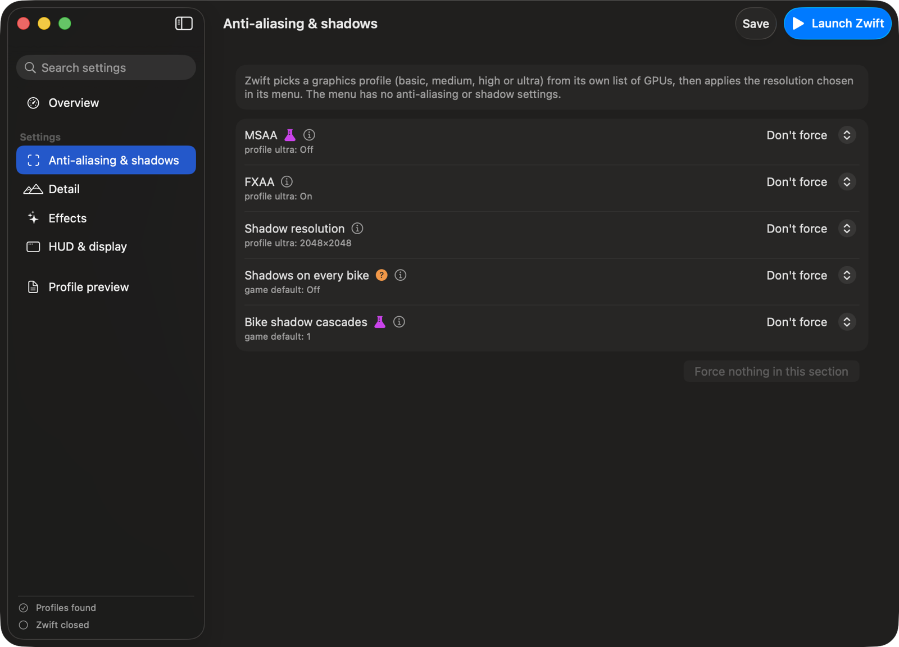

<p align="center"></p>

# Pimp My Zwift

A small macOS app that unlocks the hidden graphics settings of **Zwift** on Mac, then launches the game with them applied.

Zwift's own menu only lets you pick the resolution. Under the hood the game picks one of four graphics profiles (basic, medium, high, ultra) from its own list of GPUs, and those profiles are plain text files of console commands. The game also has a set of "tweakable" variables those files can change, most of which no profile ever touches. Pimp My Zwift exposes the graphics ones with allowed values only, shows what the game would use on its own, and explains what each one does.

<p align="center"></p>

<p align="center"></p>

> **Not affiliated with Zwift.** Zwift is a trademark of Zwift, Inc. This is an independent, unofficial tool. It does not modify the game's executables, assets or account data, and it only exposes visual settings: nothing that changes physics, power, speed or results. It only appends lines to the graphics profiles the game reads at startup. Zwift's terms of service restrict unauthorized modifications: use it at your own risk.

## AI disclosure

This project was developed with the help of AI (Anthropic's Claude), including the analysis of how Zwift applies its settings, the code and the translations.

## Features

- **Presets**: Max, Balanced, Performance, or the game's own profiles, then fine-tune any setting.
- **23 settings in 4 sections**: anti-aliasing and shadows, detail, effects, HUD and display.
- **Allowed values only**: every control is limited to values that make sense for the variable's type.
- **The game's value next to each setting**: what the profile Zwift picked sets, or the default the game registers the variable with.
- **Explanations**: what each setting does, what it costs, and how certain it is to have an effect (used by Zwift's own profiles / present in the game but not verified / experimental).
- **Your Zwift**: version, GPU, the profile picked at the last launch, the commands it ran and any variable it didn't recognize, read from Zwift's log.
- **Search**, a **preview** of exactly what will be written, automatic **backups** of the original profiles.
- **Launch Zwift** with one click (⌘R), so the settings are always in place when the game starts.
- English and Italian.

## Requirements

- macOS 13 Ventura or later, Apple Silicon or Intel.
- Zwift installed in /Applications and launched at least once.
- No special permission: Zwift isn't sandboxed and its files live in your user folders. macOS may ask to let the app read the Documents folder, where Zwift keeps its log and preferences.

## Build

Only the Xcode Command Line Tools are needed (`xcode-select --install`); Xcode itself is not.

```bash
./build.sh
open "build/Pimp My Zwift.app"
```

The build is a universal binary with an ad-hoc signature, fine for running on your own Mac.

To run the tests (the profile writer, the log reader, the settings catalog and translation coverage): `./test.sh`.

To regenerate the icon: `swift scripts/make_icon.swift`.

## How it works

Findings from analysing Zwift 1.124.0 (build 167761) on macOS:

- **Zwift is a custom C++ engine**, rendered with Metal. The launcher (`/Applications/Zwift.app`) installs the game in `~/Library/Application Support/Zwift` and starts `ZwiftAppSilicon` on Apple Silicon.
- **Graphics profiles are console scripts.** `data/configs/{basic,medium,high,ultra}.txt` contain commands such as `res 1920x1080(0x)`, `sres 2048x2048` and `set gSSAO=1`. At every launch the game matches the GPU against its own list and logs `Using ultra graphics profile`, followed by every command it runs.
- **The menu's resolution comes last.** After the profile, the game applies `USER_RESOLUTION_PREF` from `~/Documents/Zwift/prefs.xml`, without an MSAA suffix. Whether MSAA set by the profile survives is unverified, so the app marks it experimental and writes it with the same resolution.
- **Tweakables.** The game's console (`set`, `listvars`, `help`) changes "tweakable" global variables. 217 of them are registered in the binary; their names, types and default values were read from the static initializers that register them. Only visual ones are exposed here: the others drive physics, steering, braking, drafting and power-ups, and changing them would be cheating.
- **Some lines in Zwift's own files are dead.** `nAIBikes`, `bDrawTrees`, `bloomStrength` and `g_timeScalar` appear in `currentconfig.txt` and `profile.txt` but their names don't even appear in this build. On the Mac used for the analysis, the log shows only the chosen profile being read.
- **Pimp My Zwift appends its lines to all four profiles**, so the result doesn't depend on which one the game picks; later lines override earlier ones. The original of each profile is kept as `<profile>.txt.pimpmyzwift.bak`. If a Zwift update replaces a profile, the app takes the new file as the original and appends its lines again at the next launch from here.

### Not verified

- The tweakables that no Zwift profile sets (marked with an orange question mark) exist in the game with the listed defaults, but their visual effect hasn't been observed in game.
- Values beyond what Zwift itself uses (8192 shadows, LOD bias -1, foliage above 1×, more bike shadow cascades, MSAA) are marked experimental.
- After saving, launch Zwift once and check the **Your Zwift** section: it lists the commands the game ran and any variable it didn't recognize.

## License

Public domain ([The Unlicense](LICENSE)).
