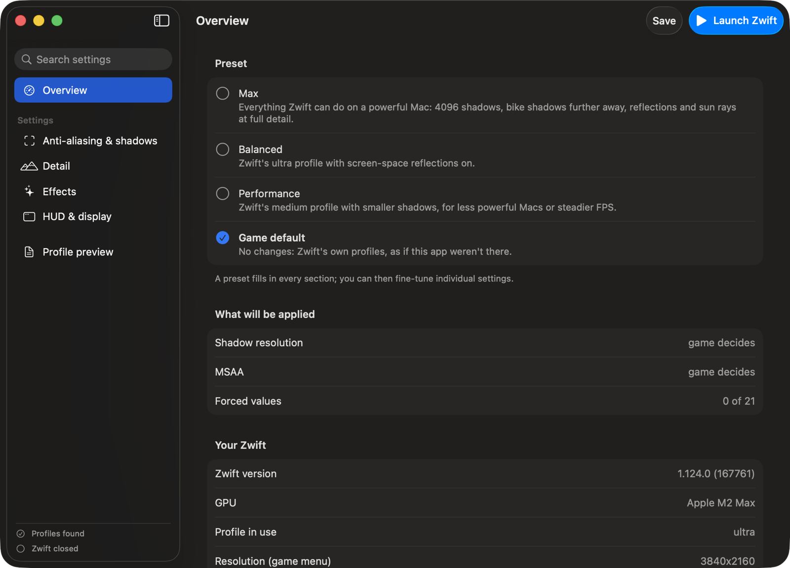
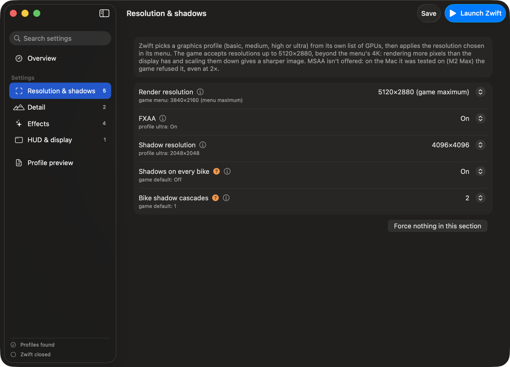

<p align="center"></p>

# Pimp My Zwift

A small macOS app that unlocks the hidden graphics settings of **Zwift** on Mac, then launches the game with them applied.

Zwift's own menu only lets you pick the resolution, up to 4K. Under the hood the game picks one of four graphics profiles (basic, medium, high, ultra) from its own list of GPUs, and those profiles are plain text files of console commands. The game also has a set of "tweakable" variables those files can change, most of which no profile ever touches. Pimp My Zwift exposes the graphics ones with allowed values only, shows what the game would use on its own, and explains what each one does.

<p align="center"></p>

<p align="center"></p>

> **Not affiliated with Zwift.** Zwift is a trademark of Zwift, Inc. This is an independent, unofficial tool. It does not modify the game's executables, assets or account data, and it only exposes visual settings: nothing that changes physics, power, speed or results. It only appends lines to the graphics profiles the game reads at startup. Zwift's terms of service restrict unauthorized modifications: use it at your own risk.

## AI disclosure

This project was developed with the help of AI (Anthropic's Claude), including the analysis of how Zwift applies its settings, the code and the translations.

## Features

- **Presets**: Max, Balanced, Performance, or the game's own profiles, then fine-tune any setting.
- **24 settings in 4 sections**: resolution and shadows, detail, effects, HUD and display. Every one of them is read by the game's code.
- **Render resolution beyond the menu**: up to 5120×2880, for supersampling on a 4K or Retina display.
- **Allowed values only**: every control is limited to the values the game's code actually handles.
- **The game's value next to each setting**: what the profile Zwift picked sets, or the default the game registers the variable with.
- **Explanations**: what each setting does, what it costs, and how certain it is to have an effect (used by Zwift's own profiles / read by the game's code but not seen in game yet / experimental).
- **Your Zwift**: version, GPU, the profile picked at the last launch, the commands it ran and any variable it didn't recognize, read from Zwift's log.
- **Search**, a **preview** of exactly what will be written, automatic **backups** of the original profiles.
- **Launch Zwift** with one click (⌘R), so the settings are always in place when the game starts.
- English and Italian.

## Requirements

- macOS 13 Ventura or later, Apple Silicon or Intel.
- Zwift installed in /Applications and launched at least once.
- No special permission: Zwift isn't sandboxed and its files live in your user folders. macOS may ask to let the app read the Documents folder, where Zwift keeps its log and preferences.

## Build

Only the Xcode Command Line Tools are needed (`xcode-select --install`); Xcode itself is not.

```bash
./build.sh
open "build/Pimp My Zwift.app"
```

The build is a universal binary with an ad-hoc signature, fine for running on your own Mac.

To run the tests (the profile writer, the log reader, the settings catalog and translation coverage): `./test.sh`.

To regenerate the icon: `swift scripts/make_icon.swift`.

## How it works

Findings from analysing Zwift 1.124.0 (build 167761) on macOS:

- **Zwift is a custom C++ engine**, rendered with Metal. The launcher (`/Applications/Zwift.app`) installs the game in `~/Library/Application Support/Zwift` and starts `ZwiftAppSilicon` on Apple Silicon.
- **Graphics profiles are console scripts.** `data/configs/{basic,medium,high,ultra}.txt` contain commands such as `res 1920x1080(0x)`, `sres 2048x2048` and `set gSSAO=1`. At every launch the game matches the GPU against its own list and logs `Using ultra graphics profile`, followed by every command it runs.
- **The menu's resolution comes last.** After the profile, the game runs `res` with `USER_RESOLUTION_PREF` from `~/Documents/Zwift/prefs.xml`, so a resolution in the profile would be overridden: Pimp My Zwift writes that preference instead, and puts the menu's choice back when the setting isn't forced.
- **The `res` command accepts more than the menu.** Its forms are `res WxH`, `res WxH(Nx)`, `res (Nx)` and `res 1.5` (a render scale from 0.25 to 2 of the window size). Explicit sizes are accepted from 320×240 up to 5120×2880, while the menu stops at 3840×2160.
- **Shadow maps stop at 4096.** `sres` accepts sides from 256 to 4096; 8192 is rejected with `Error with resolution values`.
- **MSAA is capped by the GPU.** The requested sample count is zeroed when it exceeds a maximum the game reads from the device's capabilities, and a `res` without `(Nx)` resets it anyway. On an M2 Max the game refused both 4× and 2×, so the app doesn't offer MSAA.
- **Tweakables.** The game's console (`set`, `listvars`, `help`) changes "tweakable" global variables. 217 of them are registered in the binary; their names, types and default values were read from the static initializers that register them. Only visual ones are exposed here: the others drive physics, steering, braking, drafting and power-ups, and changing them would be cheating.
- **Which tweakables actually do something.** For each exposed variable, the code that reads it was located by scanning the binary for accesses to the variable's address, then disassembled:
  - `gSSAO` and `gRadialBlur` are registered but **never read**: Zwift's high and ultra profiles still turn SSAO on, to no effect. They're not in the app.
  - `gLODBias` is clamped with an unsigned comparison to 0–2: 0 is already full detail, and a negative value turns into 2, the lowest.
  - `gFoliagePercent` multiplies each foliage instance count: 1 is the maximum, more instances than the ones loaded can't be drawn.
  - `g_BikeMaxShadowCascade` is the last shadow cascade bikes are drawn into; `gForceBikeShadows` overrides an internal hardware flag that otherwise decides whether bikes cast shadows.
  - `gSSR` turns a pass on, but the renderer checks another internal flag too.
- **Some lines in Zwift's own files are dead.** `nAIBikes`, `bDrawTrees`, `bloomStrength` and `g_timeScalar` appear in `currentconfig.txt` and `profile.txt` but their names don't even appear in this build. On the Mac used for the analysis, the log shows only the chosen profile being read.
- **Pimp My Zwift appends its lines to all four profiles**, so the result doesn't depend on which one the game picks; later lines override earlier ones. The original of each profile is kept as `<profile>.txt.pimpmyzwift.bak`. If a Zwift update replaces a profile, the app takes the new file as the original and appends its lines again at the next launch from here.

### Not verified

- The tweakables that no Zwift profile sets (marked with an orange question mark) are read by the game's code, but their visual effect hasn't been seen in game yet.
- `listvars` (the console command that would print every variable's value) is not available in the shipping build, so the final values can't be read back.

### Other options that were tried

Beyond graphics, the game reads 161 keys from prefs.xml (71 of them absent from a typical file) and registers 45 console commands. The candidates that don't touch physics, power or results were tried in game:

- **Elevation profile** (`g_elevationProfile_DrawDistanceCM`, `g_elevationProfile_Height`): works, now in the app.
- **Fireworks every night** (`g_FireworkNightShowAlwaysOn`): accepted, but night follows the server's world clock.
- **Time of day** (`time 12:00am` in a profile): only lasts until the world clock syncs with the server, then jumps to the server's time. Not in the app.
- **`MINIMAL_UI`** in prefs.xml: starts with the HUD hidden, the same as pressing H. Not in the app.
- **`GAME_ACTIVELOADING`**: a cached feature flag the game reads from prefs.xml for the current session (the server resets it for the next launch). No measurable difference in loading. Not in the app.
- **`VSYNC=0`** and **`MAINTAIN_FOCUS_FOR_BROADCAST`** in prefs.xml: read at startup, no visible or logged effect found.

### Tested in game

On an M2 Max with Zwift 1.124.0, with the Max preset, the log showed every `set` line and `sres 4096x4096` accepted and `Changed resolution to 5120 x 2880`, with the FPS counter on screen. With these settings the log also reported `loading shader GNViewUpdateLights[5][5].2 failed!` once, when entering Watopia. That variant is requested by a world material (it's named in the material's `shader` and `permutation` fields), not by the settings themselves, and the game falls back and keeps running. A third launch with Zwift's own profiles and resolution showed the same error at the same point, so it comes from the game, not from these settings.
- After saving, launch Zwift once and check the **Your Zwift** section: it lists the commands the game ran and any variable it didn't recognize.

## License

Public domain ([The Unlicense](LICENSE)).
